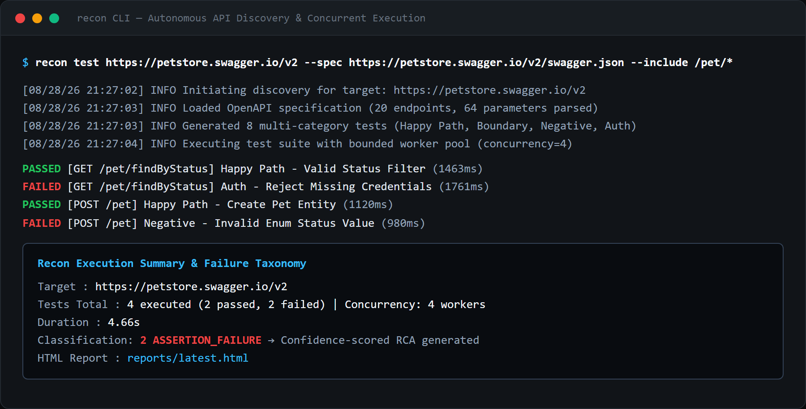
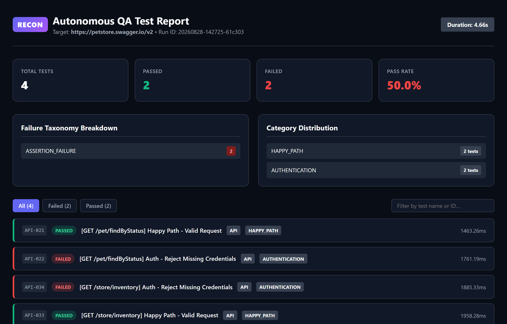
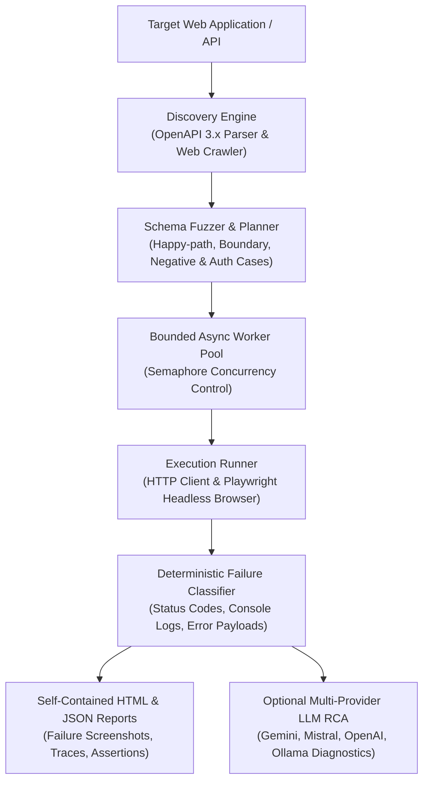

<p align="center">
  
</p>

<p align="center">
  <strong>Turn an OpenAPI spec into executable API checks and an HTML failure report.</strong>
</p>

<p align="center">
  <a href="https://pypi.org/project/recon-qa/"></a>
  <a href="https://github.com/ttnhan227/recon/actions/workflows/ci.yml"></a>
  
  <a href="https://github.com/ttnhan227/recon/blob/main/LICENSE"></a>
</p>

Recon QA discovers endpoints, derives test cases from their schemas, executes them with bounded concurrency, and writes self-contained HTML and JSON reports. It works without an AI account; LLM-assisted generation and failure analysis are optional.

> **Use Recon only on applications you own or are explicitly authorized to test.** Generated requests can create, update, or delete data described by the target API.

## Quick Start (Just 1 Command)

Requires Python 3.12 or newer.

```bash
pip install recon-qa
recon test http://localhost:8000
```

That's it. Recon automatically:
1. **Discovers** OpenAPI endpoints & web routes
2. **Generates** happy-path, boundary fuzzing, negative validation & authentication tests
3. **Executes** tests with bounded concurrency and live terminal feedback
4. **Classifies** failures with deterministic root-cause analysis
5. **Generates** a self-contained interactive HTML & JSON report

---

### Or Let the Autonomous Agent Handle It

Give Recon natural language instructions to test your web app and fix bugs:

```bash
recon agent "Test checkout on localhost:8000 and fix any bugs"
```

Or drop into an interactive QA pair-programming session:

```bash
recon agent
```

---

## Optional Commands

You only need the command above to get your testing done. These optional commands are available when you need extra control:

| Command | Description |
| :--- | :--- |
| `recon fix` | Automatically patch source code defects found in your test run |
| `recon report` | Open the interactive HTML test report in your default browser |
| `recon demo` | Run an instant zero-setup 5-second local demo with intentional defects |
| `recon config` | Configure AI provider keys (`recon set-key`) or switch models (`recon model`) |
| `recon doctor` | Check runtime, Playwright Chromium setup, and system diagnostics |

---

## Common Flags for `recon test`

```bash
# Include browser discovery & UI interaction checks
recon test http://localhost:8000 --browser

# Supply authentication
recon test http://localhost:8000 --header "Authorization: Bearer <token>"

# Limit testing to specific endpoints
recon test http://localhost:8000 --include "/api/orders*" --exclude "/api/admin*"

# Pass custom or non-standard OpenAPI specification file
recon test http://localhost:8000 --spec ./openapi.yaml
```

Reports are stored under `~/.recon/reports/` by default. Use `--report-dir` to choose another location. A test run exits with code `1` when it finds failed checks, which makes the command useful as a CI quality gate.

## See the output

Recon keeps the terminal summary concise and puts the evidence in a self-contained report. The images below come from the reproducible local demo, not a customer API.

| Terminal run | HTML report |
| :---: | :---: |
|  |  |

## Architecture & Execution Pipeline



## What Recon checks

- Discovers OpenAPI 3.x and Swagger 2.0 operations.
- Generates happy-path, validation, boundary, negative, and authentication cases.
- Uses schema constraints including types, enums, numeric ranges, string lengths, and formats.
- Orders dependent operations and can reuse IDs returned by earlier requests.
- Applies bounded asynchronous concurrency.
- Classifies HTTP, timeout, assertion, and security-related failures.
- Produces standalone HTML reports and machine-readable JSON results.
- Optionally crawls pages and runs Playwright browser checks.
- Optionally asks a configured LLM for additional cases and failure explanations.

Recon is intended to expose suspicious behavior for review. It is not a proof of correctness, a replacement for application-specific tests, or a substitute for a professional security assessment.

## AI Providers & Models

Recon works out of the box with zero configuration using deterministic failure analysis. To connect frontier reasoning models for autonomous agent tasks:

```bash
recon config set-key
# Select from Anthropic (claude-sonnet-5-5), OpenAI (gpt-6-luna), Gemini (gemini-3.8-flash), DeepSeek, Mistral, or local Ollama
```

To switch models anytime:
```bash
recon config model
```

Inspect active providers:
```bash
recon config list
```

## CI example

```yaml
name: API quality
on: [push, pull_request]

jobs:
  recon:
    runs-on: ubuntu-latest
    steps:
      - uses: actions/checkout@v4
      - uses: actions/setup-python@v5
        with:
          python-version: "3.12"
      - run: pip install recon-qa
      - run: recon test http://127.0.0.1:8000 --no-ai
```

Start your application in an earlier step and upload the chosen report directory as an artifact if the report should be retained.

## How the pipeline fits together

```text
OpenAPI document / application URL
              │
              ▼
       Endpoint discovery
              │
              ▼
  Schema-driven test generation
              │
              ▼
 Stateful, bounded execution ───── optional Playwright checks
              │
              ▼
 Deterministic classification ──── optional LLM analysis
              │
              ▼
        HTML + JSON reports
```

The LLM layer does not decide whether deterministic assertions passed or failed.

## Current limitations

- Python 3.12 or newer is required.
- Authentication discovery handles common flows but cannot infer every custom login or multi-factor workflow.
- Generated payloads are schema-driven and may not satisfy undocumented business rules.
- Browser support requires the `browser` extra and a separate Chromium installation.
- OpenAPI documents that rely heavily on vendor extensions may need a reduced reproduction and compatibility fix.
- The project is alpha software; review generated requests before pointing it at data-bearing environments.

## Development

```bash
git clone https://github.com/ttnhan227/recon.git
cd recon
python -m pip install -e ".[browser,dev]"
python -m playwright install chromium

ruff check .
ruff format --check .
mypy recon tests
pytest -q
python -m build
```

See the [contribution guide](https://github.com/ttnhan227/recon/blob/main/CONTRIBUTING.md) before proposing a change, the [roadmap](https://github.com/ttnhan227/recon/blob/main/ROADMAP.md) for current priorities, and the [changelog](https://github.com/ttnhan227/recon/blob/main/CHANGELOG.md) for release history.

## Feedback wanted

If you try Recon against a real API, please share what worked, what blocked you, and the framework or OpenAPI generator you used in the [trial feedback form](https://github.com/ttnhan227/recon/issues/new?template=feedback.yml). Sanitized minimal specifications are especially useful. See the [technical walkthrough](https://github.com/ttnhan227/recon/blob/main/docs/introducing-recon-qa.md) for a concise explanation you can share with another developer.

## License

Recon QA is available under the [MIT License](https://github.com/ttnhan227/recon/blob/main/LICENSE).
