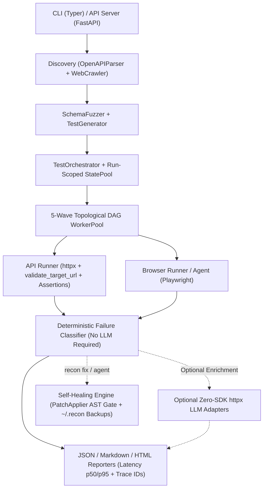
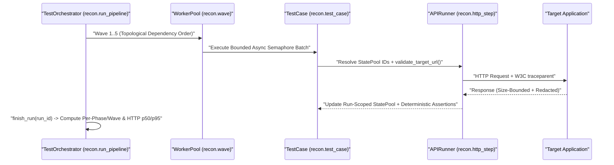

# Recon QA System Architecture

This document describes the system architecture, key architectural decisions, DAG execution model, security guardrails, OpenTelemetry instrumentation, and failure recovery behavior of **Recon QA** (`recon-qa` v`0.3.2`).

---

## 1. System Context & Component Architecture

Recon QA is a Python 3.12+ automated API and browser testing pipeline with a strictly deterministic core and optional, additive zero-SDK LLM adapters:

- **Entrypoints (`recon/apps/`)**: Typer CLI (`apps/cli/main.py`, `config_cli.py`, `doctor.py`) and FastAPI server (`apps/api/server.py`) exposing `/api/v1/runs` with `X-Trace-Id` correlation and path-safe `run_id` validation.
- **Discovery & Planning (`recon/discovery/`, `recon/planning/`)**: OpenAPI 3.x / Swagger 2.0 parser (`openapi.py`), hybrid `WebCrawler` (`web_crawler.py`, Playwright with `httpx`/`BeautifulSoup` fallback), schema fuzzer (`schema_fuzzer.py`), and dependency-aware test generator (`generator.py`).
- **Orchestration & Execution (`recon/orchestration/`, `recon/execution/`)**: `TestOrchestrator` (`orchestrator.py`), run-scoped `StatePool` (`state_pool.py`), 5-wave topological DAG `WorkerPool` (`worker_pool.py`), async `httpx` API runner (`api/runner.py`) with deterministic assertions (`api/assertions.py`), and Playwright browser runner/agent (`browser/runner.py`, `browser/agent.py`).
- **Analysis, Healing & Reporting (`recon/analysis/`, `recon/llm/`, `recon/healing/`, `recon/reporting/`)**: Deterministic root-cause classifier (`analysis/`), zero-SDK `httpx` REST LLM providers (`llm/`), AST-validated `PatchApplier` (`healing/applier.py`), and JSON/Markdown/HTML reporters with latency telemetry.

### 5-Wave DAG & OpenTelemetry Span Hierarchy

---

## 2. Key Architectural Decision Records (ADRs)

### ADR-01: Deterministic Core vs. Additive Zero-SDK LLM Adapters
- **Context:** Automated QA pipelines must remain reproducible, fast, and usable in air-gapped or CI environments without paid LLM credentials. Heavy vendor SDKs also introduce dependency churn and version conflicts.
- **Decision:** Pass/fail assertion outcomes, OpenAPI schema fuzzing, and deterministic root-cause classification never depend on an LLM. Optional AI assistance (`recon/llm/`) uses direct `httpx` REST adapters for OpenAI, Anthropic, Gemini, Mistral, DeepSeek, and Ollama without vendor SDK dependencies.
- **Trade-offs & Known Limitations:** Direct REST adapters require maintaining lightweight per-provider request/response schemas, but keep the core package lean and prevent LLM hallucinations from altering deterministic pass/fail verdicts.

### ADR-02: 5-Wave Topological DAG & Run-Scoped `StatePool` Isolation
- **Context:** REST endpoints have CRUD dependencies (e.g., `POST /orders` produces an `order_id` needed by `GET /orders/{id}` and `DELETE /orders/{id}`), and concurrent FastAPI `/api/v1/runs` executions must never leak state across runs.
- **Decision:** `WorkerPool` executes cases across a 5-wave topological DAG with bounded asyncio concurrency, backed by a per-run `StatePool` (`recon/orchestration/state_pool.py`) with exact ID substitution guards so captured resource IDs are isolated to their originating run.
- **Trade-offs & Known Limitations:** Schema-inferred dependency graphs work well for standard REST resource hierarchies, but undocumented cross-resource business preconditions may require custom specs or manual seeds.

### ADR-03: AST-Validated Whole-File Self-Healing with External Hashed Backups
- **Context:** Writing LLM-generated patches directly into a repository risks syntax corruption or leaving stray `.bak` files inside the user's git working tree.
- **Decision:** `PatchApplier` (`recon/healing/applier.py`) enforces a pre-apply `ast.parse` (for `.py`) / `json.loads` (for `.json`) syntax gate, copies the original file to a collision-free SHA-256-hashed backup under `~/.recon/backups/{project_slug}/`, writes the modified content, performs a post-write syntax sanity check with automatic rollback on error, and re-verifies against the unredacted `TestCase`.
- **Trade-offs & Known Limitations:** Whole-file syntax validation guarantees syntactic validity for Python and JSON, not semantic correctness; non-Python/JSON files pass through without an AST parser and rely on re-running the failing test case.

### ADR-04: Bounded In-Memory Per-Run Telemetry with Opt-In OTLP Export
- **Context:** Users running `recon test` locally or in CI need phase/wave timing and HTTP p50/p95 latency breakdowns inside generated reports without standing up an external tracing backend.
- **Decision:** `recon/common/telemetry.py` registers a `RunScopedSpanProcessor` (`max_runs = 200`, `max_spans_per_run = 10000`, LRU eviction) that captures `recon.run_pipeline -> recon.wave -> recon.test_case -> recon.http_step` spans per `run_id` and pops them on `finish_run(run_id)`. OTLP HTTP export activates only when `otel_exporter_otlp_endpoint` is explicitly configured.
- **Trade-offs & Known Limitations:** High-volume runs exceeding 10,000 spans truncate additional in-memory span capture to protect process memory; external OTLP export is recommended for very large suites.

---

## 3. Data Integrity, Concurrency & Security Boundaries

| Boundary | Mechanism & Implementation |
| :--- | :--- |
| **SSRF Protection** | `validate_target_url()` in `recon/common/security.py` is enforced consistently across API runners, browser agents, and self-healing re-verification to block unsafe/internal targets when restricted. |
| **Secret Redaction** | `redact_headers`, `redact_sensitive_data`, and `redact_url` scrub Authorization tokens, cookies, API keys, and credentials before persisting reports, logs, or telemetry while keeping unredacted `TestCase` data in memory for healing re-verification. |
| **TLS & Payload Limits** | `ReconSettings` (`recon/common/config.py`) provides configurable `verify_tls` and `max_response_size_bytes` truncation to prevent OOM on oversized target responses. |
| **API Server Isolation** | `recon/apps/api/server.py` enforces path-safe `run_id` validation, maps upstream/validation errors to structured `400` / `422` / `502` responses, and isolates each run's `StatePool` and `RunScopedSpanProcessor` buffer. |
| **Persistence Isolation** | Local SQLite (`aiosqlite`) state defaults to `~/.recon/recon.db`; automated tests isolate DB and report outputs to temporary fixtures. |

---

## 4. Observability & Operational Readiness

- **OpenTelemetry Pipeline (`recon/common/telemetry.py`):** Emits hierarchical spans (`recon.run_pipeline`, `recon.wave`, `recon.test_case`, `recon.http_step`) using W3C `TraceContextTextMapPropagator` to inject/extract `traceparent` on outbound HTTP checks and inbound FastAPI requests.
- **Response & Log Correlation:** FastAPI emits `X-Trace-Id` headers, and `JSONLogFormatter` correlates structured log lines with active `trace_id`, `span_id`, and `run_id`.
- **Report Telemetry:** JSON, Markdown, and HTML reports include trace IDs, per-phase/per-wave durations, and HTTP p50/p95 latency summaries computed from run-scoped spans.
- **Diagnostics Command:** `recon doctor` (`recon/apps/cli/doctor.py`) verifies Python runtime, configuration, and Playwright Chromium readiness.

---

## 5. Failure Scenarios & Recovery Matrix

| Failure Mode | System Behavior | Safeguard / Recovery | Known Limit |
| :--- | :--- | :--- | :--- |
| **Concurrent `/api/v1/runs` executions** | Multiple runs execute concurrently in the same FastAPI process. | Run-scoped `StatePool`, `current_run_id` contextvar, and `RunScopedSpanProcessor` isolate state and spans per `run_id`. | Single-process SQLite persistence can contend under high concurrent write volume. |
| **Target unreachable, SSRF blocked, or oversized response** | `validate_target_url()` rejects blocked targets; `httpx` errors/timeouts are caught per test case; responses exceeding `max_response_size_bytes` are truncated. | FastAPI maps errors cleanly to `400`/`422`/`502`; deterministic classifier records failure category without crashing the pipeline. | Truncated oversized JSON bodies may skip deep schema field assertions. |
| **Self-healing patch introduces syntax error** | `PatchApplier.apply_patch` checks `ast.parse` / `json.loads` before writing and re-checks after write. | Pre-write gate leaves target file untouched; post-write failure immediately restores from `~/.recon/backups/{project_slug}/<name>.<hash>.recon.bak`. | Non-Python/JSON languages rely on test re-execution rather than AST validation. |
| **LLM provider unavailable or unconfigured** | LLM adapter raises timeout/auth error or is skipped (`--no-ai`). | Deterministic assertions, schema fuzzing, failure classification, and HTML/JSON reports complete normally with zero LLM dependency. | Natural-language narrative explanations and autonomous patching are skipped when no provider is reachable. |
| **Playwright Chromium missing on host** | `WebCrawler` cannot launch headless Chromium. | Falls back to `httpx` + `BeautifulSoup` discovery; `recon doctor` surfaces missing browser binaries. | Client-side SPA interactions requiring JS execution are not exercised in fallback mode. |

---

## 6. Verified Engineering & Testing Evidence

### Automated Test Suites & Static Checks (Verified in Repository)

| Suite / Gate | Command | Verified Coverage & Scope |
| :--- | :--- | :--- |
| **Automated Test Suite (`pytest`)** | `python -m pytest -p no:cacheprovider -v tests/` | **115 test functions across 22 test modules** using FastAPI ASGI + in-memory `aiosqlite`, covering OpenAPI parsing, schema fuzzing, 5-wave DAG orchestration, `StatePool` isolation, SSRF & redaction (`test_security.py`), self-healing AST/rollback (`test_self_healing.py`), OpenTelemetry spans & latency reports (`test_telemetry.py`), LLM adapters, and HTML/Markdown reporters. |
| **Lint & Format (`ruff`)** | `ruff check . && ruff format --check .` | 0 lint or formatting issues across `recon/` and `tests/`. |
| **Static Typing (`mypy`)** | `mypy recon tests` | 0 type errors across `recon/` and `tests/`. |

### Known Verification Gaps & Unmeasured Benchmarks
- **Live Browser & CLI Coverage:** Automated baseline tests run against FastAPI ASGI + in-memory `aiosqlite` with mocked browser/network boundaries; live external Playwright Chromium crawling (`WebCrawler`/`BrowserTestRunner`) and interactive `CliRunner` sessions are not exercised in the default offline unit suite.
- **Large-Spec Throughput & Memory Scaling:** **Not measured under production load.**
- **Recommended Benchmark Method:** Run `recon test` against a synthetic 200-endpoint OpenAPI 3.1 service with `--no-ai`, varying `WorkerPool` concurrency limits while inspecting `RunScopedSpanProcessor` peak memory and per-wave duration in the generated JSON report.
